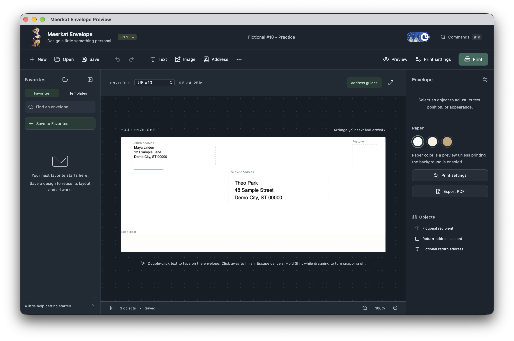

# Badger Downloads

Official installers for Badger Hub and the apps in its collection. Source code is maintained separately.

## Public beta

Meerkat Envelope is available as a public beta. The package version is `2.0.0-alpha.2`; the file names and app still use Preview. This is an early testing release with unfinished acceptance checks.

[Download Meerkat Envelope for Mac or Windows](https://github.com/czayas-0314/Badger-Downloads/releases/tag/meerkat-v2.0.0-alpha.2).

The Mac app has a Developer ID signature but is not notarized. The Windows packages are unsigned. Your computer may warn or block installation. Read [the beta installation notes](BETA.md) before downloading. No GitHub account is needed for public downloads.

## Meerkat Envelope Preview

Design envelopes with text and artwork, save Favorites, and print or export a PDF. The Rust preview runs on Mac and Windows. Its interface supports light and dark appearance. The envelope keeps its own paper and ink colors.

Meerkat Envelope is for personal, non-commercial use under its included license. Third-party components retain their own licenses.

| Computer | Package |
| --- | --- |
| Mac, Apple silicon or Intel, macOS 14 or later | [Universal DMG](https://github.com/czayas-0314/Badger-Downloads/releases/download/meerkat-v2.0.0-alpha.2/Meerkat-Envelope-Preview-2.0.0-alpha.2-macos-universal.dmg) |
| Windows 11, Intel or AMD | [Windows x64 installer](https://github.com/czayas-0314/Badger-Downloads/releases/download/meerkat-v2.0.0-alpha.2/Meerkat-Envelope-Preview-2.0.0-alpha.2-windows-x86_64.exe) |
| Windows 11 on ARM | [Windows ARM64 installer](https://github.com/czayas-0314/Badger-Downloads/releases/download/meerkat-v2.0.0-alpha.2/Meerkat-Envelope-Preview-2.0.0-alpha.2-windows-aarch64.exe) |

Badger Hub selects a compatible download. Its Windows ZIP packages are for managed Hub installation and updates. Standalone Windows users can use the EXE installer for their processor.

The preview still requires hardware and physical-printing acceptance. Keep a copy of important designs and use the envelope size that matches the paper loaded in your printer. The preview installs separately from earlier Meerkat apps.

[Release notes](MEERKAT_BETA_RELEASE.md) describe the changes and testing limits. Report a problem through [Issues](https://github.com/czayas-0314/Badger-Downloads/issues). Include your operating system and app version. Remove real names and addresses from reports and screenshots.

## Updates

Each Meerkat version has one release containing its Mac and Windows packages. Checksums and dependency notices accompany the downloads. The signed Hub catalog points to version-specific assets. App updates keep documents and Favorites in their separate data folders.

The Hub catalog is published through the `catalog` release. App packages use `meerkat-vVERSION` tags. Hub installers use `badger-hub-vVERSION` tags.
