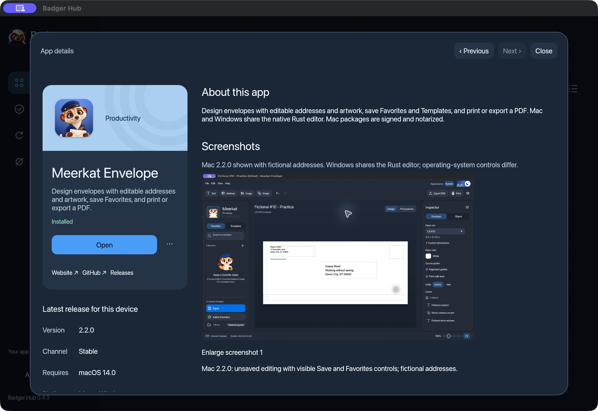
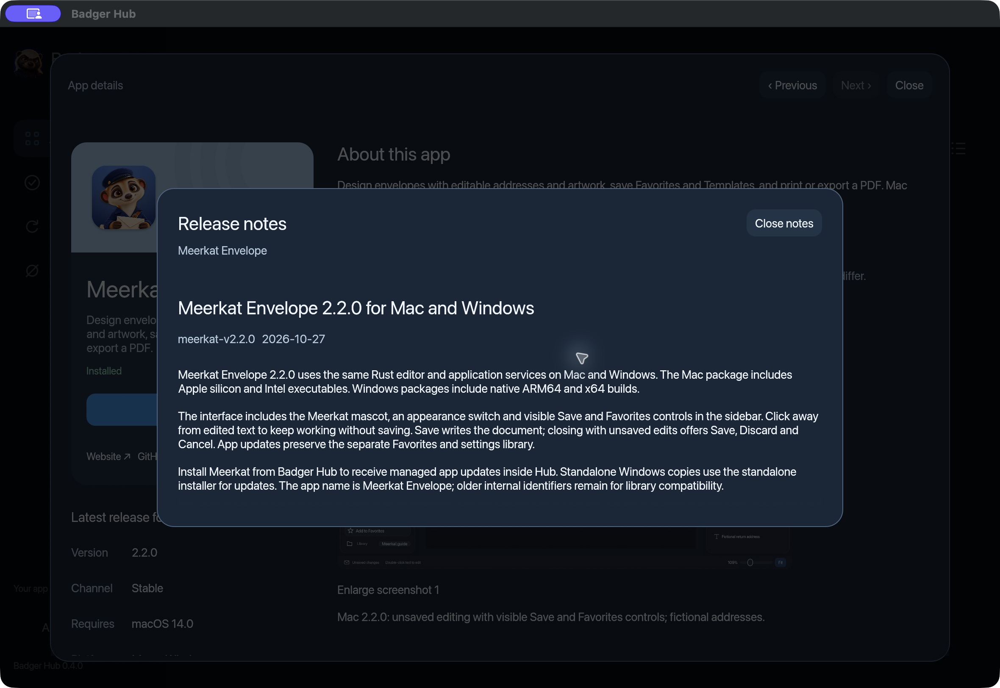

# Badger Hub — installation & user guide

**Browse, install, open, and update your Badger apps from one desktop library.**

Badger Hub runs on Mac and Windows. You can search the collection, compare screenshots and release information, install a compatible app, and check for updates without opening a separate download page for every app. Hub downloads and installation do not require a GitHub account or a Hub sign-in.

[Download Hub](../README.md#download-hub) · [0.4.0 release](https://github.com/czayas-0314/Badger-Downloads/releases/tag/badger-hub-v0.4.0) · [Report a problem](https://github.com/czayas-0314/Badger-Downloads/issues/new)

## In this guide

- [Choose your download](#choose-your-download)
- [Install on Mac](#install-on-mac)
- [Install on Windows](#install-on-windows)
- [Your first app](#your-first-app)
- [Explore the library](#explore-the-library)
- [Keep Hub and your apps up to date](#keep-hub-and-your-apps-up-to-date)
- [Troubleshooting](#troubleshooting)
- [Verify a download](#verify-a-download)
- [Release files, licenses, and feedback](#which-release-file-do-i-need)

## Choose your download

The current Hub release is **0.4.0**.

| Your computer | Installer |
| --- | --- |
| Apple silicon Mac — an Apple M-series chip | [Mac DMG](https://github.com/czayas-0314/Badger-Downloads/releases/download/badger-hub-v0.4.0/Badger-Hub-0.4.0-macos-aarch64.dmg) |
| Windows with an Intel or AMD x64 processor | [Windows x64 setup EXE](https://github.com/czayas-0314/Badger-Downloads/releases/download/badger-hub-v0.4.0/Badger-Hub-0.4.0-windows-x86_64-setup.exe) |
| Windows on ARM — including Snapdragon computers | [Windows ARM64 setup EXE](https://github.com/czayas-0314/Badger-Downloads/releases/download/badger-hub-v0.4.0/Badger-Hub-0.4.0-windows-aarch64-setup.exe) |

On Mac, choose **Apple menu → About This Mac** and look for the chip. On Windows, open **Settings → System → About → System type**. Use ARM64 for an ARM-based processor and x64 for an x64-based processor.

Hub 0.4.0 does not include an Intel Mac build. [Earlier Hub betas](https://github.com/czayas-0314/Badger-Downloads/releases?q=badger-hub) include Intel-compatible downloads, but have different features and signing status. Windows 11 is the current testing target. The Windows x64 package was tested through emulation on Windows ARM64; native Intel/AMD hardware acceptance is still outstanding.

Internet access is needed to refresh the catalog, download apps, load online release history, and check for updates. Each app has its own operating-system requirements. Read **Requires** in its details before installing; for example, Meerkat Envelope 2.2.0 for Mac requires macOS 14 or later.

## Install on Mac

1. Download the **Mac DMG** above.
2. Open `Badger-Hub-0.4.0-macos-aarch64.dmg` from Downloads.
3. Drag **Badger Hub.app** into **Applications**.
4. Launch **Badger Hub** from Applications. Confirm the normal first-open prompt if macOS asks whether to open a downloaded app.
5. Once the copy is complete, eject the disk image. Use the copy in Applications for future launches and updates.

The 0.4.0 Mac app and disk image are **Developer ID signed, notarized, and stapled**. If macOS reports that this release is damaged or cannot be verified, download a fresh copy from the official release page and report the exact message if it persists. Keep macOS security protections enabled.

If you already have Hub, quit it before manually replacing the app. Keep your existing libraries and settings folders in place.

## Install on Windows

1. Download the **x64 EXE** or **ARM64 EXE** that matches your processor.
2. Open the installer from Downloads.
3. Follow the setup screens. The default location is `%LOCALAPPDATA%\Programs\Badger Hub` for your Windows user account.
4. Open **Start → Badger Apps → Badger Hub**.

The installers are **not Authenticode signed**. Windows may display an unknown-publisher or SmartScreen warning, and an organization-managed computer may block installation. Check that the download came from this repository and verify its checksum if needed. Follow your organization's software policy; do not turn off Windows security protections to install Hub.

Publisher signatures on the update ZIPs are used by Hub's updater. They do not make the standalone EXE a Windows-signed installer.

## Your first app

1. Open **All apps** and let Hub refresh its catalog.
2. Search for an app or choose a category.
3. Select its card or list row to open **App details**. Review the description, screenshots, version, release channel, and **Requires** information.
4. Choose **Install** when a compatible package is available. Follow any confirmation shown by Hub and wait for installation to finish.
5. Choose **Open** to launch the installed app.

The catalog currently includes Meerkat Envelope for envelope design and Cappy Comm messaging previews. Available platforms and preview status vary by app and can change independently of Hub. A Hub download does not include every app: you install the apps you want from the library.



*App details show compatibility and screenshots before you install. This is a real Mac capture; addresses inside the Meerkat example are fictional.*

## Explore the library

| Control | What it does |
| --- | --- |
| **All apps** | Browse the catalog with search, category filters, sorting, and grid or list view. |
| **Installed** | Find the apps Hub recognizes on your computer and open them. |
| **Updates** | Review available app updates and Hub's own update status. |
| **Hidden apps** | Restore apps you previously hid from the library. |
| **About & settings** | Choose System, Light, or Dark appearance. Hub remembers your choice. |
| **App options (•••)** | Open release notes and available app-management actions or links. Unavailable actions are disabled. |

**Read release history inside Hub.** Choose **Read release notes** from app details or **Release notes** from the app menu. The scrollable window includes older published releases. Close it to return to the app details or library.



**Hide without uninstalling.** Use **Hide App** to remove an app from the main library, then restore it through **Hidden apps** when you want it back.

**Mac app management.** For verified supported installations, **Show in Finder**, **Reinstall**, and **Uninstall** are available. Quit the app first. Uninstall moves the verified app bundle to Trash and keeps its saved documents and settings. These management actions are currently Mac-specific and are disabled where unsupported, including on Windows.

## Keep Hub and your apps up to date

### Update an app

1. Save your work and quit the app you want to update.
2. Open **Updates** in Hub.
3. Choose **Update** on the app's card when available.
4. Wait for completion, then reopen the app.

Hub manages updates for apps installed through Hub. A copy installed independently may be detected and opened, but can require its original installer for updates. If Hub says a copy was installed outside Hub, use that app's standalone installer.

### Update Hub itself

1. Open **Updates**.
2. Choose **Check for Hub updates**.
3. When an update is available, choose **Update & restart**.

Hub checks when it opens, when it returns to the foreground, and every 15 minutes while its window is visible. The Updates badge counts both Hub and app updates. A failed check is an error, not confirmation that you have the newest version.

Updates are designed to preserve libraries and settings stored separately from application files. Keep backups of important documents, especially when using preview apps. Do not delete an app's data folder as a troubleshooting shortcut.

## Troubleshooting

| What you see | What to try |
| --- | --- |
| **An empty or outdated library** | Clear search and category filters, check **Hidden apps**, then use the refresh control. Check your internet connection if catalog refresh fails. |
| **No compatible Install button** | Read the app's platform and **Requires** details. An app may have a Mac release or a preview for only one Windows architecture. |
| **An app must be closed before updating** | Save your work, quit that app completely, and retry from Hub. |
| **Installed outside Badger Hub** | Update that copy with its original installer. Do not remove its saved data to make Hub manage it. |
| **Update or release-history check failed** | Check the connection and retry. Record the exact error if it continues. |
| **Windows blocks the installer** | Confirm the architecture and official download location. Review the unsigned-installer note above and your organization's policy. |
| **macOS cannot verify the download** | Use a fresh copy of the 0.4.0 DMG from the official page. If the message persists, report it with your macOS version. |

## Verify a download

This is optional. The release includes a [SHA256SUMS file](https://github.com/czayas-0314/Badger-Downloads/releases/download/badger-hub-v0.4.0/SHA256SUMS) listing the SHA-256 hash for each published installer and update file.

On Mac, run this in Terminal after downloading the DMG:

```sh
shasum -a 256 ~/Downloads/Badger-Hub-0.4.0-macos-aarch64.dmg
```

On Windows, run this in PowerShell for the x64 installer, or replace the filename with the ARM64 installer name:

```powershell
Get-FileHash "$HOME\Downloads\Badger-Hub-0.4.0-windows-x86_64-setup.exe" -Algorithm SHA256
```

Compare the full result with the matching filename in `SHA256SUMS`; letter case does not matter. If they differ, do not run the file. Download a fresh copy and report a repeat mismatch. A checksum checks that your file matches the published bytes; it does not replace operating-system signing or establish that software is free of bugs.

## Which release file do I need?

| File | Purpose |
| --- | --- |
| **`.dmg`** | Normal Mac installation. |
| **`-setup.exe`** | Normal Windows installation; match x64 or ARM64 to your computer. |
| **`.app.tar.gz` / Windows `.zip`** | Packages used by Hub's update process. Most people should use the DMG or EXE. |
| **`.sig`** | Detached publisher signatures for update packages. They are not applications. |
| **`badger-hub-updates.json`** | Update metadata read by Hub. No manual setup is needed. |
| **`SHA256SUMS`** | Optional download-integrity verification. |
| **`-notices.zip`** | Third-party dependency notices and required source material. |
| **GitHub's “Source code” ZIP / TAR.GZ** | An archive of this downloads repository, not an installer or the private Hub application source. |

## Licenses and feedback

Downloads are free, but each application has its own license. Meerkat Envelope is licensed for personal, non-commercial use. Read the license supplied with each app before use. Third-party components retain their own licenses; Hub's [notices archive](https://github.com/czayas-0314/Badger-Downloads/releases/download/badger-hub-v0.4.0/Badger-Hub-0.4.0-notices.zip) accompanies the release.

[Open an issue](https://github.com/czayas-0314/Badger-Downloads/issues/new) for a bug, installation problem, or feature suggestion. Include:

- App name and version, plus Hub version if relevant.
- Operating system and processor type: Apple silicon, Windows ARM64, or Windows x64.
- Steps to reproduce, expected behavior, actual behavior, and exact error text.
- A screenshot or small sample when useful, with private information removed.

Screenshots in this guide were captured from the installed Mac version of Hub 0.4.0. Catalog contents can change without a Hub release. Mac and Windows share the interface; system controls and available management actions differ.
