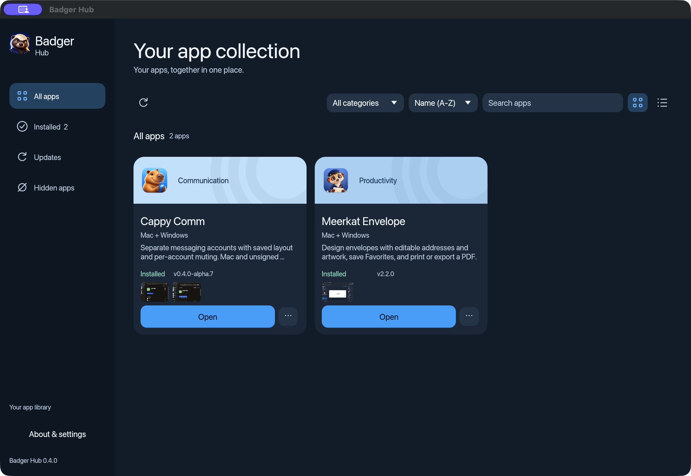
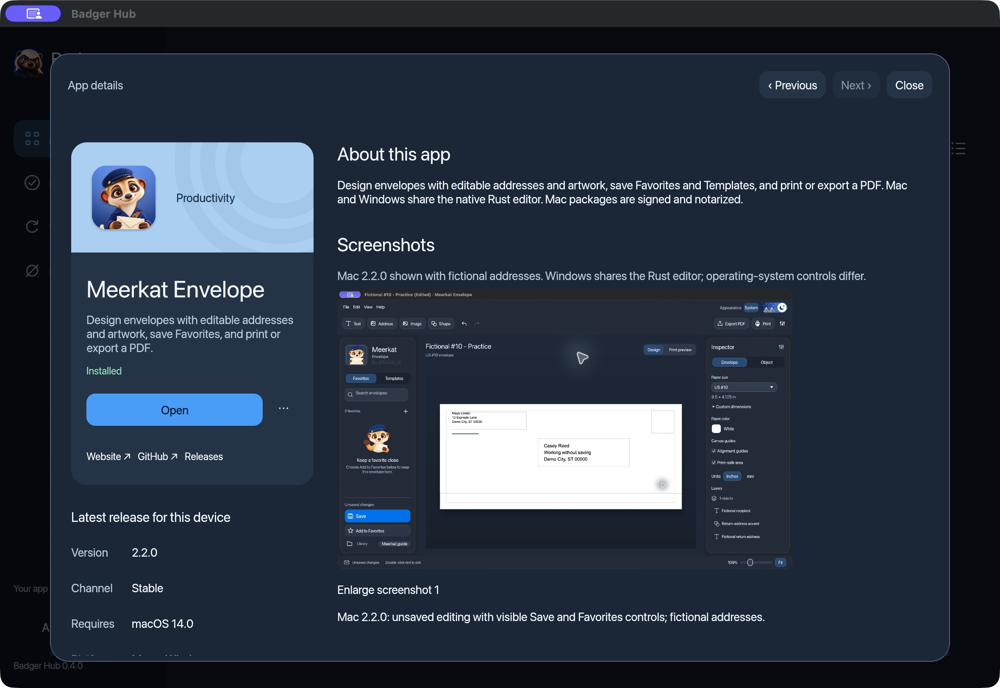
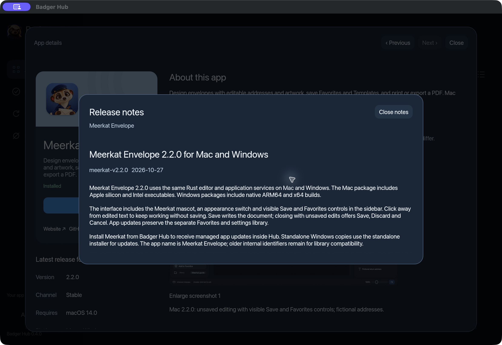

<p align="center">
  
</p>

<h2 align="center">Your apps, together in one place.</h2>

<p align="center">Badger Hub 0.4.0 · Mac with Apple silicon · Windows ARM64 &amp; x64</p>

**Badger Hub is your desktop library for Badger apps.** Browse descriptions and screenshots, install compatible apps, open them, and manage available updates in one place. Downloads are free and require no GitHub account or Hub sign-in.

## Download Badger Hub

Choose the installer for your computer. These links download the file directly.

| Your computer | Download 0.4.0 |
| --- | --- |
| **Mac with Apple silicon — M-series chip** | **[Download for Mac · DMG](https://github.com/czayas-0314/Badger-Downloads/releases/download/badger-hub-v0.4.0/Badger-Hub-0.4.0-macos-aarch64.dmg)** |
| **Windows with Intel or AMD** | **[Download for Windows · x64 EXE](https://github.com/czayas-0314/Badger-Downloads/releases/download/badger-hub-v0.4.0/Badger-Hub-0.4.0-windows-x86_64-setup.exe)** |
| **Windows on ARM — including Snapdragon** | **[Download for Windows on ARM · ARM64 EXE](https://github.com/czayas-0314/Badger-Downloads/releases/download/badger-hub-v0.4.0/Badger-Hub-0.4.0-windows-aarch64-setup.exe)** |

On Mac, check **Apple menu → About This Mac** for your chip. On Windows, check **Settings → System → About → System type**.

**Intel Mac:** This release has no Intel Mac package. [Earlier Hub betas](https://github.com/czayas-0314/Badger-Downloads/releases?q=badger-hub) include Intel-compatible downloads, with different features and signing status. Windows 11 is the current testing target. Each app in Hub has its own operating-system and processor requirements.

[Full installation & user guide](https://github.com/czayas-0314/Badger-Downloads/blob/main/docs/badger-hub.md) · [All Hub releases](https://github.com/czayas-0314/Badger-Downloads/releases?q=badger-hub) · [Help & feedback](https://github.com/czayas-0314/Badger-Downloads/issues)

## A look inside Hub



*A real screenshot of the installed Mac app. Catalog contents and app versions can change. Windows shares the interface, with platform-specific controls and management actions.*

## What's new in 0.4.0

- **A refreshed blue interface** on Mac and Windows, with smaller app cards that fit more of the library in the window.
- **App details in one place:** select an app to see its description, screenshots, compatible version, and install or open controls.
- **Release history inside Hub:** read release notes in a scrollable window, including older published releases.
- **Honey badger branding on Windows**, including the app and installer icon.

Search, category filtering, sorting, grid and list views, and in-Hub updates remain available. Choose System, Light, or Dark appearance in **About & settings**. Hide apps from the library and restore them through **Hidden apps**.

<details>
<summary><strong>See app details and release history</strong></summary>

### Check an app before installing



Read the description, confirm the release channel and **Requires** information, and enlarge a screenshot before choosing **Install**. The addresses shown in the Meerkat example are fictional.

### Read what changed



Choose **Read release notes** in app details or **Release notes** from the app menu. Close the window to return to your library or app details.

</details>

## Install on Mac

1. Download and open `Badger-Hub-0.4.0-macos-aarch64.dmg`.
2. Drag **Badger Hub.app** into **Applications**.
3. Launch **Badger Hub** from Applications and confirm the normal downloaded-app prompt if shown.
4. Eject the disk image after copying. Use the Applications copy for future launches and updates.

Already installed? Quit Hub before manually replacing the app. Keep your existing libraries and settings folders in place.

The Mac app and DMG are **Developer ID signed, notarized, and stapled**. If macOS reports that this release is damaged or cannot be verified, download a fresh copy from this page and report a persistent error. Keep macOS security protections enabled.

## Install on Windows

1. Download the matching **x64** or **ARM64** setup EXE.
2. Open the installer and follow its setup screens.
3. The default installation is per user, in `%LOCALAPPDATA%\Programs\Badger Hub`.
4. Open **Start → Badger Apps → Badger Hub**.

**Windows signing notice:** These EXE installers are **not Authenticode signed**. Windows may show an unknown-publisher or SmartScreen warning, and managed computers may block installation. Check the official download location and, if needed, the checksum below. Follow your organization's software policy and keep Windows security protections enabled.

The update ZIPs have a separate publisher signature used by Hub's updater. That signature is not a Windows code-signing certificate.

## Get started

1. Open **All apps** and let Hub refresh the catalog.
2. Search or filter the library, then select an app to view its details.
3. Review the release channel, screenshots, and **Requires** information.
4. Choose **Install** when a compatible release is available; once it finishes, choose **Open**.

Apps are downloaded separately. The collection currently includes Meerkat Envelope for envelope design and Cappy Comm messaging previews. Their supported platforms, preview status, and licenses vary. For example, Meerkat Envelope 2.2.0 for Mac requires macOS 14 or later.

On Mac, supported verified installations also offer **Show in Finder**, **Reinstall**, and **Uninstall**. Uninstall moves the app bundle to Trash while keeping saved documents and settings. These actions are disabled on platforms or installations where they are unavailable.

## Updates and saved data

- **Update an app:** save your work, quit that app, open **Updates** in Hub, and choose **Update** when available.
- **Update Hub:** open **Updates → Check for Hub updates**, then choose **Update & restart** when offered.
- **Automatic checks:** Hub checks on launch, when brought to the foreground, and every 15 minutes while its window is visible. A failed check does not mean you are up to date.
- **Standalone app copies:** an app installed outside Hub may require its original installer for updates. Follow the message shown by Hub.

Updates are designed to preserve libraries and settings stored separately from application files. Keep backups of important documents, especially when trying preview apps.

## Download integrity and release files

Hub verifies the app catalog's publisher signature and downloaded app checksums. Its own update packages also use publisher signatures. For a manual download, you can compare your file with [SHA256SUMS](https://github.com/czayas-0314/Badger-Downloads/releases/download/badger-hub-v0.4.0/SHA256SUMS).

<details>
<summary><strong>Optional: verify your installer</strong></summary>

On Mac, run in Terminal:

```sh
shasum -a 256 ~/Downloads/Badger-Hub-0.4.0-macos-aarch64.dmg
```

On Windows, run in PowerShell, substituting the ARM64 filename if that is your download:

```powershell
Get-FileHash "$HOME\Downloads\Badger-Hub-0.4.0-windows-x86_64-setup.exe" -Algorithm SHA256
```

Compare the entire hash with the matching filename in `SHA256SUMS`. Letter case does not matter. Do not run a file whose hash differs. Download it again and report a repeat mismatch. A checksum verifies the published bytes; it does not replace operating-system signing.

</details>

| Asset | What it is for |
| --- | --- |
| **DMG / setup EXE** | Normal installation. Choose the file for your platform above. |
| **`.app.tar.gz` / Windows `.zip`** | Packages used by Hub's updater. Most people should use the DMG or EXE. |
| **`.sig` / `badger-hub-updates.json`** | Publisher signatures and update metadata. No manual configuration is required. |
| **`SHA256SUMS`** | Optional integrity checks for published downloads. |
| **`Badger-Hub-0.4.0-notices.zip`** | Dependency notices and required third-party source material. |
| **GitHub's “Source code” archives** | Archives of the public downloads repository, not Hub installers or the private application source. |

## Verification and known limits

The release record reports **64 passing Mac tests** and **65 passing tests for each Windows architecture**, with fixture-dependent tests skipped. Mac and Windows update checks covered preservation of separate profile data. The Mac package was signed and notarized before publication.

**Windows x64 was tested under Windows ARM64 emulation, not on native Intel or AMD hardware.** Windows installers remain unsigned by Authenticode. The screenshots above show Mac; operating-system controls and some app-management actions differ on Windows.

These are the existing 0.4.0 packages. This expanded download guide does not change the installers or update feed.

## Help, feedback, and licenses

If installation, updates, or an app fail, [open an issue](https://github.com/czayas-0314/Badger-Downloads/issues/new). Include the app and version, operating system, processor type, steps to reproduce, and exact error text. Remove private account details, names, and addresses from screenshots and sample files.

Downloads are free. Each app has its own license; Meerkat Envelope is for personal, non-commercial use. Third-party components retain their own licenses. [Download Hub's notices archive](https://github.com/czayas-0314/Badger-Downloads/releases/download/badger-hub-v0.4.0/Badger-Hub-0.4.0-notices.zip) for dependency notices and required source material.
